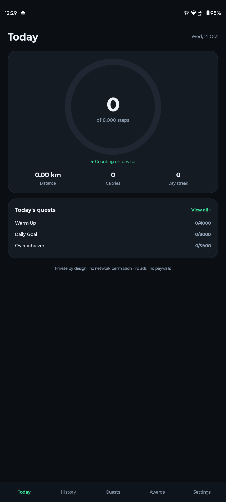
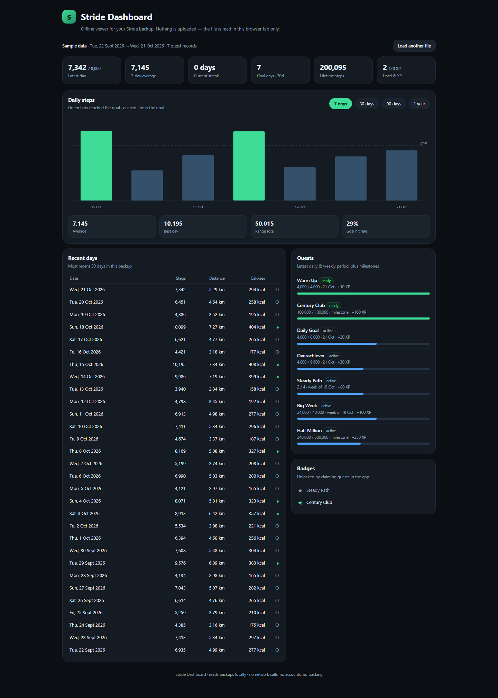

# Stride

A fully private, offline step tracker for Android — plus a single-file browser
dashboard for your laptop.

No account. No cloud. No ads. No analytics. No paywall. No `INTERNET` permission
at all. Steps are read from the phone's hardware pedometer and stored in a local
SQLite database.



More screens: [History](docs/history.png) · [Quests](docs/quests.png) · [Settings](docs/settings.png)

## What's here

| Path | Purpose |
|---|---|
| `out/stride.apk` | Signed, release APK ready to sideload |
| `src/com/darsha/steps/` | Native Android app (Java, single activity) |
| `assets/quests.json` | Data-driven quest definitions |
| `dashboard/index.html` | Offline laptop dashboard (open in any browser) |
| `build.ps1` | Build + align + sign without Gradle |
| `install.ps1` | `adb install` + launch |
| `out/` | Build output and verification screenshots (recreated on each build) |

## Install

Requirements: Android 8.0+ (API 26) with a hardware step counter, and USB
debugging enabled.

```powershell
.\install.ps1
# or:
adb install -r out\stride.apk
```

On first launch, allow **Physical activity** so the step sensor can be read.
Allow **Notifications** for the required foreground-service notification and
optional daily reminders. Counting continues if notification permission is
denied; only the notification/reminders are affected.

## Build from source

No Gradle, no Android Studio project — just the SDK tools:

- Windows PowerShell
- JDK 17 (`JAVA_HOME`, or the default path in `build.ps1`)
- Android SDK with platform `android-34`, build-tools, and platform-tools
  (`ANDROID_HOME` / `ANDROID_SDK_ROOT`, or `%LOCALAPPDATA%\Android\Sdk`)
- A local signing key. `build.ps1` uses `key.jks` (alias `stride`) and reads the
  password from `STEPS_KEY_PASS` or `keystore.env.ps1`. If `key.jks` is missing
  it creates one. **Keep `key.jks` and the password private, and keep them if
  you want to upgrade-install future builds.**

```powershell
.\build.ps1                 # release APK -> out\stride.apk
.\build.ps1 -Debug -OutDir out-debug   # debuggable build with demo-data tools
```

The build script deletes and recreates the output directory on every run.
The debug build adds a **Debug tools** card in Settings (seed 14 demo days,
write/read test exports). Release builds hide that card behind the
`FLAG_DEBUGGABLE` check, so it is absent from the shipped APK.

## Using the app

- **Today** — progress ring, steps vs. goal, distance, calorie estimate, current
  day streak, and today's quests.
- **History** — 7 / 30 / 90 / 365-day bar chart, average, best day, total, goal
  hit rate, and a recent-days table.
- **Quests** — daily, weekly, and lifetime quests. Completed quests are claimed
  manually for XP. Daily quests reset at local midnight, weekly quests on Monday.
  Missing a day never removes past XP or badges. Level thresholds are quadratic:
  level 2 at 100 XP, level 3 at 400 XP, level 4 at 900 XP, and so on
  (`100 × (level−1)²`).
- **Awards** — earned badges from weekly and milestone quests.
- **Settings** — goal (default 8,000), stride length (72 cm), weight (70 kg),
  km/mi units, daily reminder (default 8:00 PM), JSON/CSV export, JSON import,
  battery-optimization shortcut, and permission shortcuts.

### Quest set

- **Daily:** Warm Up (50% of goal, +10 XP), Daily Goal (100%, +20 XP),
  Overachiever (120%, +30 XP).
- **Weekly:** Steady Path (goal on 4 days, +80 XP, badge), Getting Out
  (1,000+ steps on 3 days, +50 XP), Big Week (5× daily goal, +100 XP).
- **Milestones:** 100k / 500k / 1M lifetime steps, 10k in one day, and 7 / 30-day
  goal streaks — each with XP and a badge.

Targets adapt to your daily goal at runtime. Definitions live in
`assets/quests.json`.

## Privacy architecture

- **No `INTERNET` permission.** Verified against the built APK; there is no
  networking code, no third-party SDK, no ads, and no analytics.
- Data lives only in the app's private SQLite database. `android:allowBackup` is
  `false`, so Android cloud backup does not copy it.
- A foreground service reads `TYPE_STEP_COUNTER` directly (falling back to
  `TYPE_STEP_DETECTOR`). It does **not** use Google Fit or Health Connect.
- The sensor is cumulative, so after the service is killed or the app is
  reopened, counting catches up from the hardware counter instead of losing the
  interval.
- Exports are written only to a location you pick through Android's system file
  picker. Nothing is uploaded. Once exported, a file is outside the app's
  control — share it carefully.
- The foreground-service notification is an Android requirement for continuous
  counting. It can be minimized by the system; the app never hides data in it.

## Backups and data formats

### JSON (full backup)

Settings → **Export JSON backup** creates a versioned file like:

```json
{
  "app": "Stride",
  "schemaVersion": 1,
  "exportedAt": "2026-10-21T12:26:44Z",
  "xp": 110,
  "settings": {
    "goal": 8000,
    "stride_cm": 72,
    "weight_kg": 70,
    "units": "km",
    "reminder_on": false,
    "reminder_minutes": 1200
  },
  "days": [
    {
      "date": "2026-10-21",
      "steps": 4000,
      "distance_m": 2880.0,
      "calories": 160.0,
      "goal": 8000,
      "goal_reached": false
    }
  ],
  "quests": [
    {
      "id": "daily_warmup",
      "period": "2026-10-21",
      "state": "claimed",
      "progress": 4000,
      "target": 4000,
      "claimed_at": 1792590000000
    }
  ],
  "achievements": ["century"],
  "definitions": [
    {
      "id": "daily_warmup",
      "title": "Warm Up",
      "category": "daily",
      "type": "daily_steps",
      "xp": 10,
      "badge": ""
    }
  ]
}
```

`definitions` is included so the dashboard can show quest titles, categories,
and badges even if its built-in quest set is older than yours.

**Importing replaces everything**: days, quests, achievements, settings, and XP.
It also resets the internal sensor baseline (it never trusts a baseline from
another device or an old install). The import accepts only `app: "Stride"` and
`schemaVersion: 1`; anything else is rejected before data is changed.

### CSV (rows for spreadsheets)

`date,steps,distance_m,calories,goal,goal_reached` — newest day first. CSV is
one-way and does not contain quests, achievements, XP, or settings.

## Laptop dashboard



Open `dashboard/index.html` directly in a modern browser (double-click it — no
server, no build step, no internet). Then:

1. Drag your exported JSON or CSV onto the page, or use **Choose file**.
2. Use the 7 / 30 / 90 / 365-day buttons to change the chart range.
3. **View sample data** demonstrates the dashboard without an export.
4. **Load another file** resets it.

JSON exports power the chart, summary cards, recent-days table, quest progress,
level/XP, and badges. CSV exports power the chart and summary cards only (there
is no quest data in CSV). Everything is parsed locally in the browser; the
dashboard has no CDN, no fonts, and no network calls. It validates the
`app: "Stride"` marker on JSON files.

The dashboard is responsive and was checked at desktop and 390 px mobile widths.
On this Motorola device, Android's system picker stores exported files under
`Download/MediaStorePlugin/`; the exact folder varies by OEM. Use **Load another
file** in the dashboard after re-exporting.

## Project layout

```text
private-steps/
├─ AndroidManifest.xml
├─ assets/quests.json
├─ src/com/darsha/steps/
│  ├─ MainActivity.java       UI, tabs, permissions, export/import
│  ├─ StepService.java        foreground sensor service
│  ├─ Store.java              SQLite schema, streaks, quest state, backups
│  ├─ QuestEngine.java        quest evaluation, XP, badges
│  ├─ Charts.java             progress ring + bar chart views
│  ├─ NotificationHelper.java channels, ongoing notification, reminders
│  ├─ Reminders.java          AlarmManager scheduling
│  ├─ BootReceiver.java       restart service after reboot/update
│  └─ ReminderReceiver.java   daily reminder receiver
├─ dashboard/index.html
├─ build.ps1
├─ install.ps1
├─ key.jks                    local signing key (keep private)
├─ keystore.env.ps1           local signing password (keep private)
└─ out/stride.apk
```

## Known limitations

- **Hardware pedometer required** for automatic counting. Without a step
  counter the app falls back to the step detector; some devices lack both or
  report inconsistently.
- **Android 14 boot restriction:** health foreground services may not be allowed
  to start directly from `BOOT_COMPLETED`. Stride attempts the restart, but if
  the OS blocks it, steps catch up from the cumulative hardware counter the next
  time the app is opened. No counted steps are lost while the phone stays on.
- **OEM battery optimization** can stop the service. Use the Settings shortcut
  and allow Stride to run in the background for all-day counting.
- **Reminders are approximate** (AlarmManager, no exact-alarm permission) and
  require notification permission. They are a nudge, not a guaranteed timer.
- **Distance and calories are estimates** based on stride length and weight;
  this is a personal tracker, not a medical or fitness-certified device.
- **Timezone/day-boundary changes** can move steps between local dates; data is
  stored per local calendar day.
- Exported backups contain your step history. Store/share them accordingly.
- The dashboard is read-only; importing or editing data is done in the app.

## Verification performed

On a physical Android 14 Motorola device:

- Release APK installed and launched; release build exposes no debug tools.
- `TYPE_STEP_COUNTER` (`step_count`) registered and active for
  `com.darsha.steps.StepService`; persistent foreground service running.
- Fresh state after clearing app data: 0 steps, empty history, Level 1 / 0 XP,
  reminder off, default goal 8,000.
- JSON export through the system file picker and JSON import verified
  ("Imported 14 day(s)"), including quest definitions and XP/achievements.
- Daily reminder alarm scheduled and observed in `dumpsys alarm`; canceled when
  the reminder is switched off.
- Dashboard tested in Chromium with a real JSON backup, a real CSV export, the
  built-in sample, and a 390 px mobile viewport — no console errors.
- APK checks: no `INTERNET` permission, not debuggable, `apksigner` verified.

**Artifact:** `out/stride.apk` — 45,519 bytes, SHA-256
`5338DD0B459F64C30073DE88A6F817E6785738A4CA7144BFE199A386DBAAB6B2`.
Signer: `CN=stride` (local key). Bump `versionCode` in `AndroidManifest.xml` for
future upgrades, and sign with the same `key.jks`.
